# World Masters Sport event details

Reference pack scraped from [https://www.worldmasterssport.com/about-the-masters-games/next-masters-games/](https://www.worldmasterssport.com/about-the-masters-games/next-masters-games/) on **2026-08-19**.

This folder is design/content research for the IMGA Athlete POC. It is **not** mock fixture data and is not imported by app screens.

Listing-card images are saved as shown on the source page. The Abu Dhabi carousel card currently reuses the Taipei 101 photo.

## Upcoming events

| Image | Event | Status | Country | Dates | Sports |
|---|---|---|---|---|---|
| 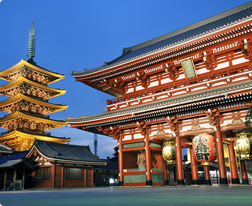 | [WMG Kansai 2027](upcoming/wmg-kansai-2027.md) | Open Now ! | Japan | 14 -30 May 2027 | 35 |
| 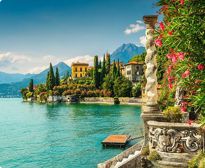 | [OMG Como Lake 2027](upcoming/omg-como-lake-2027.md) | Opening Fall 2026 | Italy | 17-26 Sept 2027 | 25 |
|  | [WWMG Lahti 2028](upcoming/wwmg-lahti-2028.md) | Pre-Register Now | Finland | 14-23 Jan 2028 | 12 |
|  | [WMG Perth 2029](upcoming/wmg-perth-2029.md) | Opening 2028 | Australia | 12-23 Oct 2029 | TBD |

## Previous events (listing carousel)

| Image | Event | Status | Country | Dates | Sports |
|---|---|---|---|---|---|
|  | [Abu Dhabi 2026](previous/abu-dhabi-2026.md) | Previous | UAE | 6 – 15 Feb 2026 | 30+ |
| 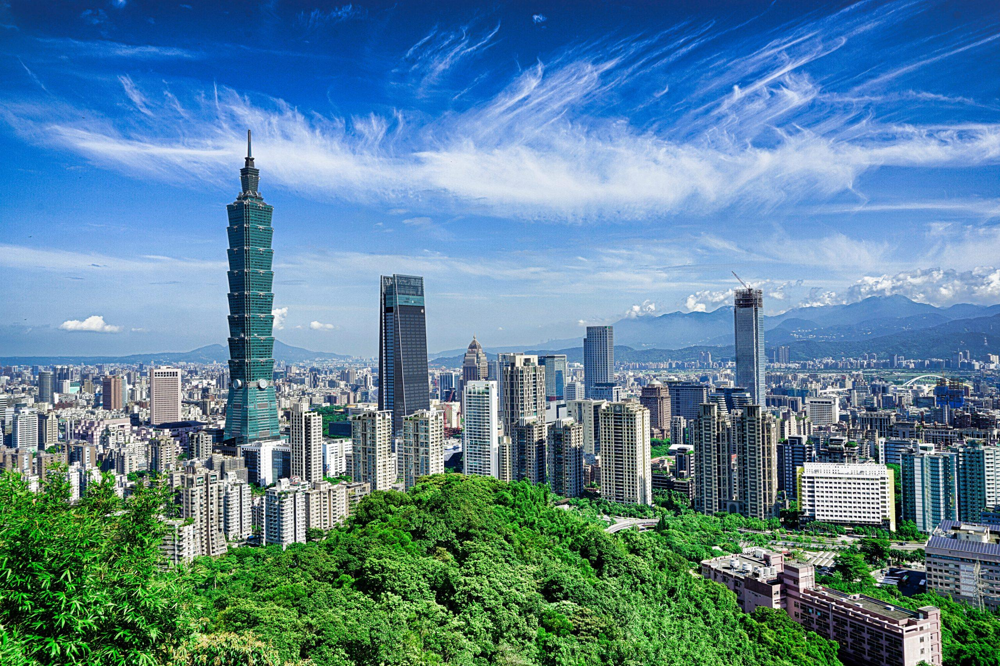 | [Taipei 2025](previous/taipei-2025.md) | Previous | Taiwan | 17 – 30 May 2025 | 35 |
| 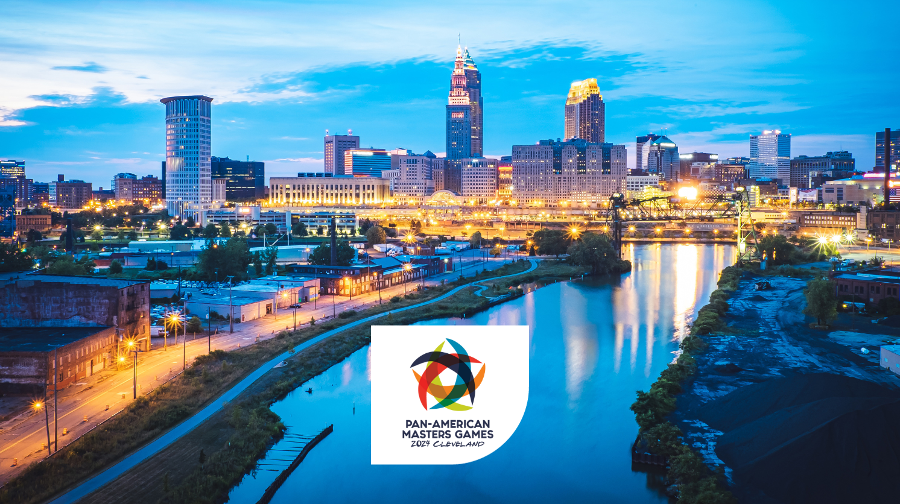 | [Cleveland 2024](previous/cleveland-2024.md) | Previous | USA | 12 – 21 Jul 2024 | 24 |
| 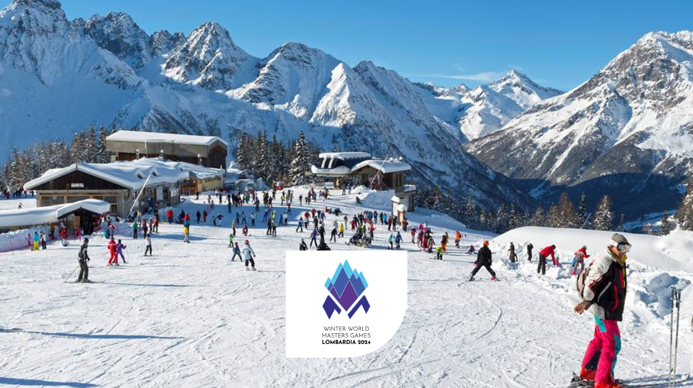 | [Lombardia 2024](previous/lombardia-2024.md) | Previous | Italy | 12 – 21 Jan 2024 | 10 |
| 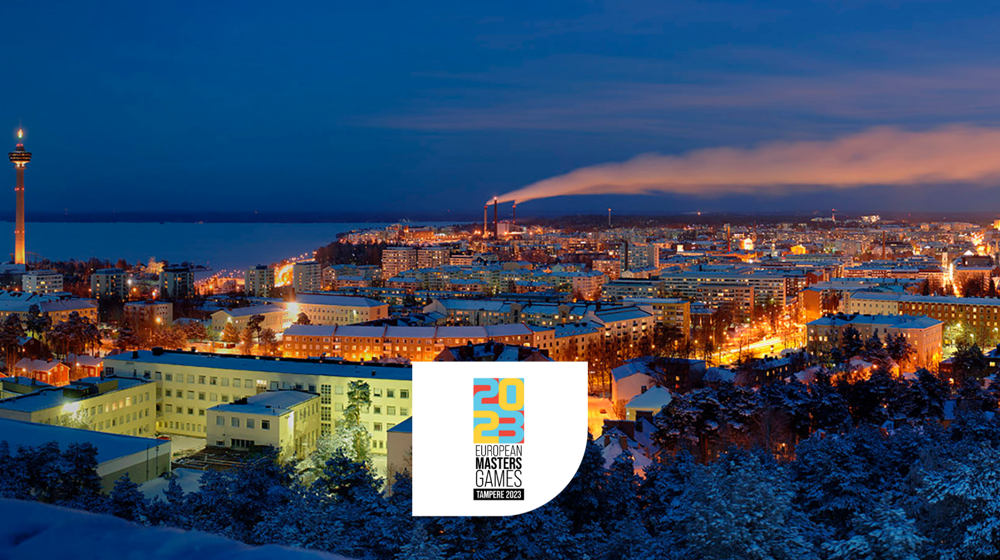 | [Tampere 2023](previous/tampere-2023.md) | Previous | Finland | 26 – 09 Jul 2023 | 29 |
| 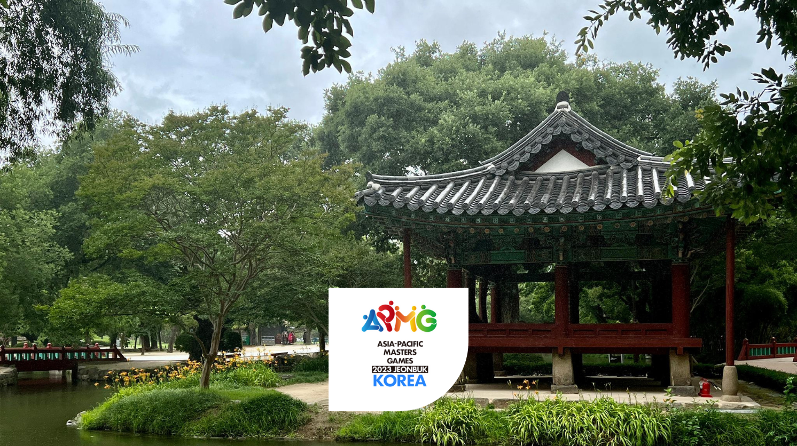 | [Jeonbuk 2023](previous/jeonbuk-2023.md) | Previous | South Korea | 12 – 20 May 2023 | 29 |
| 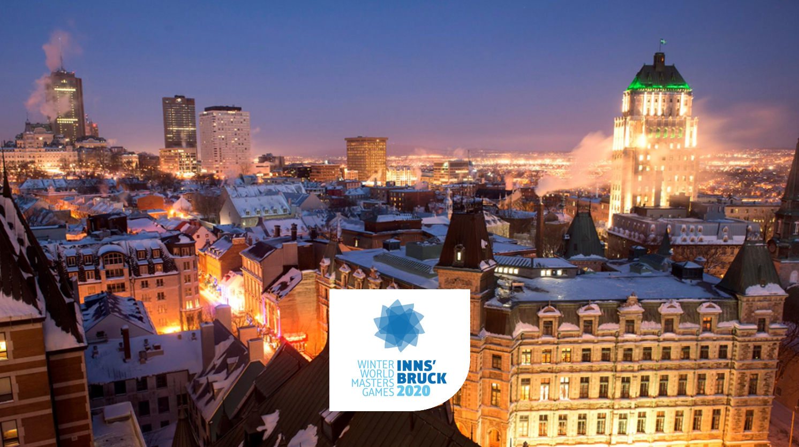 | [Innsbruck 2020](previous/innsbruck-2020.md) | Previous | Austria | 10 – 19 Jan 2020 | 12 |
| 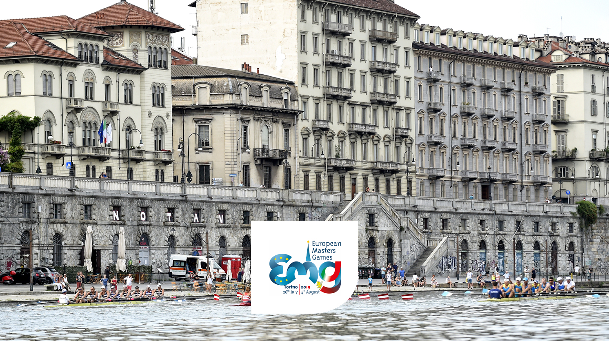 | [Torino 2019](previous/torino-2019.md) | Previous | Italy | 26 – 04 Aug 2019 | 28 |
| 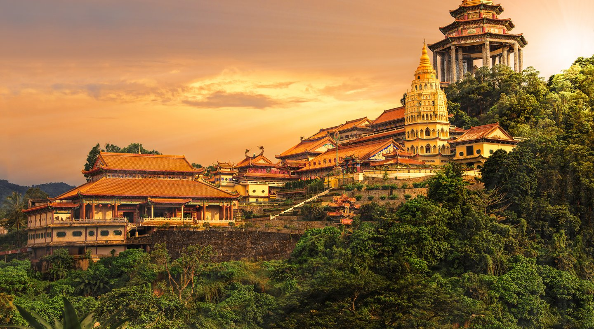 | [Penang 2018](previous/penang-2018.md) | Previous | Malaysia | 08 – 16 Sept 2018 | 22 |
| 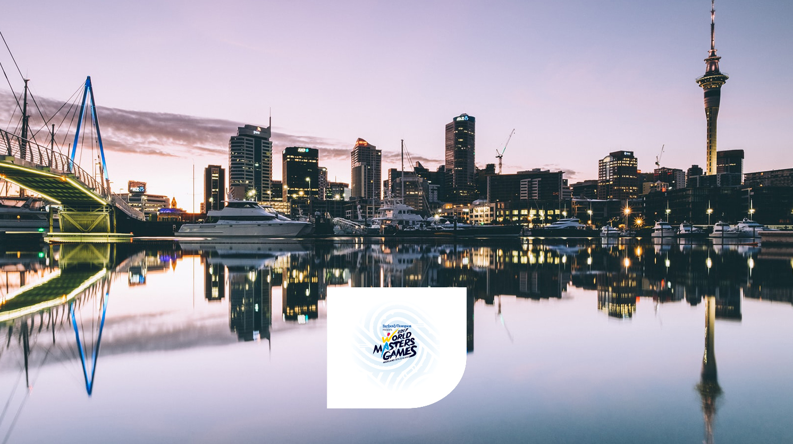 | [Auckland 2017](previous/auckland-2017.md) | Previous | New Zealand | 21 – 30 Apr 2017 | 28 |
| 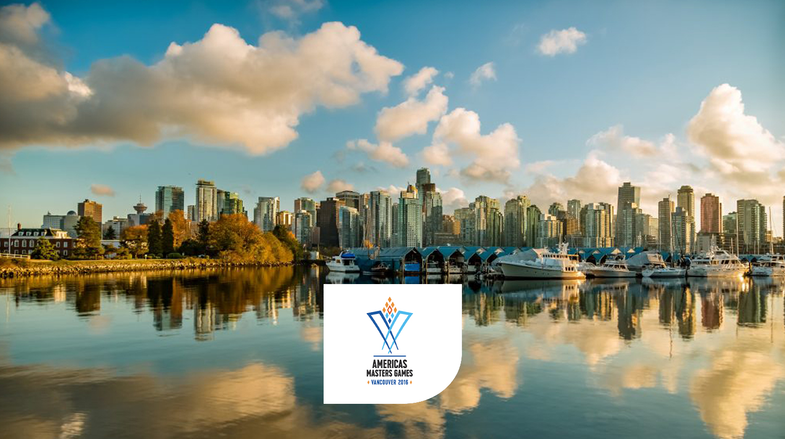 | [Vancouver 2016](previous/vancouver-2016.md) | Previous | Canada | 26 – 04 Sep 2016 | 23 |
| 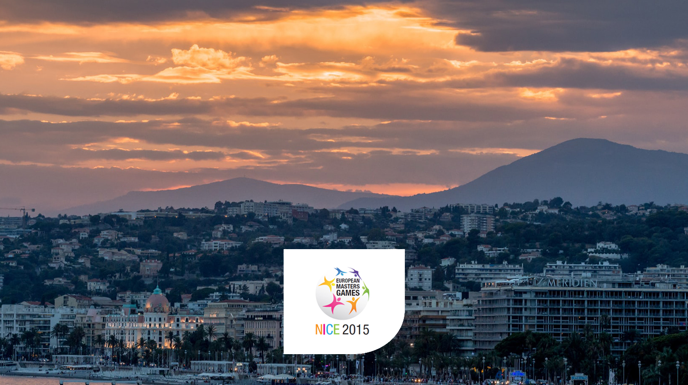 | [Nice 2015](previous/nice-2015.md) | Previous | France | 01 – 11 Oct 2015 | 27 |
| 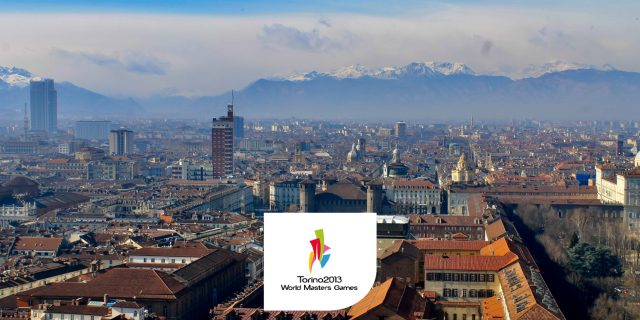 | [Torino 2013](previous/torino-2013.md) | Previous | Italy | 02 – 11 Aug 2013 | 26 |
|  | [Sydney 2009](previous/sydney-2009.md) | Previous | Australia | 10 – 18 Oct 2009 | 28 |

## All events since 1985 (site list)

- Toronto 1985
- Aarhus 1989
- Brisbane 1994
- Portland 1998
- Melbourne 2002
- Edmonton 2005
- Malmö 2008
- Sydney 2009
- Bled 2010
- Lignano 2011
- Torino 2013
- Nice 2015
- Quebec 2015
- Vancouver 2016
- Auckland 2017
- Penang 2018
- Torino 2019
- Innsbruck 2020
- Jeonbuk 2023
- Tampere 2023
- Lombardia 2024
- Cleveland 2024
- Taipei 2025
- Abu Dhabi 2026
- Kansai 2027
- Como 2027
- Lahti 2028
- Perth 2029

## Map markers on the same page

| ID | Tooltip | Lat | Lng | URL |
|---|---|---|---|---|
| OMG Abu Dhabi 2026 | 2026 Open Masters Games Abu Dhabi | 24.466667 | 54.366669 | https://www.worldmasterssport.com/about-the-masters-games/next-masters-games/abu-dhabi-2026/ |
| WMG Kansai 2027 | 2027 World Masters Games Kansai | 34.6937 | 135.5023 | https://www.worldmasterssport.com/about-the-masters-games/all-masters-games/world-masters-games__trashed/kansai-2027/ |
| OMG Como Lake 2027 | 2027 Open Masters Games Como Lake | 45.8081 | 9.0852 | https://www.worldmasterssport.com/about-the-masters-games/next-masters-games/como-lake-2027/ |
| WWMG Lahti 2028 | 2028 Winter World Masters Games Lahti | 60.9827 | 25.6615 | https://www.worldmasterssport.com/about-the-masters-games/next-masters-games/lahti-2028 |
| WMG Perth 2029 | 2029 World Masters Games Perth | -31.9505 | 115.8605 | https://www.worldmasterssport.com/about-the-masters-games/next-masters-games/perth-2029 |
| WMG Sydney 2009 | 2009 World Masters Games Sydney | -33.8727 | 151.2057 | https://www.worldmasterssport.com/about-the-masters-games/all-masters-games/world-masters-games/sydney-2009/ |
| WMG Auckland 2017 | 2017 World Masters Games Auckland | -36.8509 | 174.7645 | https://www.worldmasterssport.com/about-the-masters-games/all-masters-games/world-masters-games/auckland-2017/ |
| WMG Torino 2013 | 2013 World Masters Games Torino | 45.0703 | 7.6869 | https://www.worldmasterssport.com/about-the-masters-games/all-masters-games/world-masters-games/torino-2013/ |
| WMG Edmonton 2005 | 2005 World Masters Games Edmonton | 53.5461 | -113.4937 | https://www.worldmasterssport.com/about-the-masters-games/all-masters-games/world-masters-games/edmonton-2005/ |
| WMG Melbourne 2002 | 2002 World Masters Games Melbourne | -37.8136 | 144.9631 | https://www.worldmasterssport.com/about-the-masters-games/all-masters-games/world-masters-games/melbourne-2002/ |
| WMG Portland 1998 | 1998 World Masters Games Portland | 45.5152 | -122.6784 | https://www.worldmasterssport.com/about-the-masters-games/all-masters-games/world-masters-games/portland-1998/ |
| WMG Brisbane 1994 | 1994 World Masters Games Brisbane | -27.4705 | 153.0260 | https://www.worldmasterssport.com/about-the-masters-games/all-masters-games/world-masters-games/brisbane-1994/ |
| WMG Aarhus 1989 | 1989 World Masters Games Aarhus | 56.1629 | 10.2039 | https://www.worldmasterssport.com/about-the-masters-games/all-masters-games/world-masters-games/aarhus-1989/ |
| WMG Toronto 1985 | 1985 World Masters Games Toronto | 43.6532 | -79.3832 | https://www.worldmasterssport.com/about-the-masters-games/all-masters-games/world-masters-games/toronto-1985/ |
| EMG Malmo 2008 | 2008 European Masters Games Malmo | 55.6050 | 13.0038 | https://www.worldmasterssport.com/about-the-masters-games/all-masters-games/european-masters-games/malmo-2008/ |
| EMG Lignano 2011 | 2011 European Masters Games Lignano | 45.6684 | 13.1040 | https://www.worldmasterssport.com/about-the-masters-games/all-masters-games/european-masters-games/lignano-2011/ |
| EMG Nice 2015 | 2015 European Masters Games Nice | 43.7102 | 7.2620 | https://www.worldmasterssport.com/about-the-masters-games/all-masters-games/european-masters-games/nice-2015/ |
| EMG Torino 2019 | 2019 European Masters Games Torino | 45.0703 | 7.6869 | https://www.worldmasterssport.com/about-the-masters-games/all-masters-games/european-masters-games/torino-2019/ |
| EMG Tampere 2023 | 2023 European Masters Games Tampere | 61.4971 | 23.7526 | https://www.worldmasterssport.com/about-the-masters-games/all-masters-games/european-masters-games/tampere-2023/ |
| APMG Penang 2018 | 2018 Asia Pacific Masters Games Penang | 5.4141 | 100.3285 | https://www.worldmasterssport.com/about-the-masters-games/all-masters-games/asia-pacific-masters-games/penang-2018/ |
| APMG Jeonbuk 2023 | 2023 Asia Pacific Masters Games Jeonbuk | 35.7492 | 127.1259 | https://www.worldmasterssport.com/about-the-masters-games/all-masters-games/asia-pacific-masters-games/jeonbuk-2023/ |
| PMG Vancouver 2016 | 2016 Pan American Masters Games Vancouver | 49.2827 | -123.1207 | https://www.worldmasterssport.com/about-the-masters-games/all-masters-games/pan-american-masters-games/vancouver-2016/ |
| PMG Cleveland 2024 | 2024 Pan American Masters Games Cleveland | 41.4993 | -81.6944 | https://www.worldmasterssport.com/about-the-masters-games/all-masters-games/pan-american-masters-games/cleveland-2024/ |
| WWMG Bled 2010 | 2010 Winter World Masters Games Bled | 46.3683 | 14.1146 | https://www.worldmasterssport.com/about-the-masters-games/all-masters-games/winter-world-masters-games/bled-2010/ |
| WWMG Quebec 2015 | 2015 Winter World Masters Games Quebec | 46.8131 | -71.2075 | https://www.worldmasterssport.com/about-the-masters-games/all-masters-games/winter-world-masters-games/quebec-2015/ |
| WWMG Innsbruck 2020 | 2020 Winter World Masters Games Innsbruck  | 47.2675 | 11.3910 | https://www.worldmasterssport.com/about-the-masters-games/all-masters-games/winter-world-masters-games/innsbruck-2020/ |
| 2024 Lombardia WWMG | 2024 Winter World Masters Games Lombardy | 45.4791 | 9.8452 | https://www.worldmasterssport.com/about-the-masters-games/all-masters-games/winter-world-masters-games/lombardia-2024/ |

## Folder layout

- `upcoming/` — one markdown file per upcoming event, plus `upcoming/images/`
- `previous/` — one markdown file per previous-event carousel card, plus `previous/images/`
