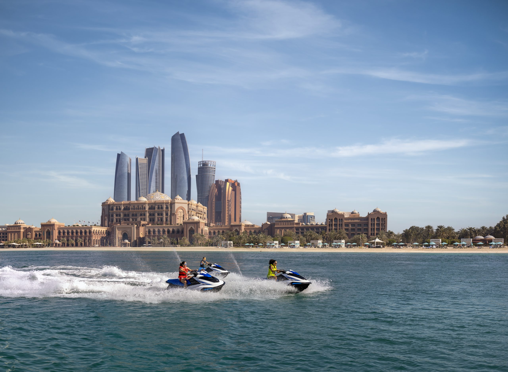

# Abu Dhabi 2026

Scraped from [World Masters Sport — Next Masters Games](https://www.worldmasterssport.com/about-the-masters-games/next-masters-games/) on 2026-08-19 for IMGA athlete POC reference.

- **Event page:** https://www.worldmasterssport.com/about-the-masters-games/next-masters-games/abu-dhabi-2026/
- **Map label:** 2026 Open Masters Games Abu Dhabi

| Field | Value |
|---|---|
| Status | Previous (event page banner: Closed) |
| Event family | Open Masters Games |
| Country / location | UAE |
| Dates | 6 – 15 Feb 2026 |
| Sports (count) | 30+ |
| Venues | 23 |
| Participants | — |
| Latitude | 24.466667 |
| Longitude | 54.366669 |
| Listing CTA | SEE MORE → https://www.abudhabimastersgames2026.com |

## Listing card

**Status banner:** Previous

**Listing copy:** Find out about Open Masters Games Abu Dhabi 2026

**CTA:** SEE MORE — https://www.abudhabimastersgames2026.com

## Event page details

**On-page title:** Abu Dhabi 2026

**On-page subtitle:** Open Masters Games

**Theme / hero line:** Countdown to the experience in this spectacular city with the ultimate mix of sporting and leisure has begun!

The perfect combination of playing sports, discovering new places, and having fun with like-minded people from all over the world, has begun!

## Sports programme

### Member sports

- Archery
- Athletics
- Badminton
- Basketball
- Canoe Kayak
- Cycling
- Football
- Golf
- Orienteering
- Shooting
- Squash
- Table Tennis
- Tennis
- Triathlon
- Volleyball
- Weightlifting

### Other sports

- Bowling
- Cricket
- Horse Jumping
- Jiu-Jitsu
- Judo
- Karate
- Netball
- Obstacle Race
- Padel
- Rugby
- Sailing
- Wrestling
- Camel Race
- Al Tabba
- Endurance Horse Race
- Falconry
- Chess
- Muay Tai
- Swimming

## Registration fees

_No fee table/screenshot published on the event page (or not applicable for a past event)._

## Athlete comments

**“You just don’t want to leave”**

“It’s impossible to let go, once you taste this adventure, when you come to these countries and compete and have these feelings and podium and everything. You just want it to continue.”

**“You make friends for life at these events”**

“We see people this year we saw in Torino, and we see them at other places and you start to see people again. Compete against people and you become friends over a period of time.”

## Source notes

- Images are local copies of public assets on worldmasterssport.com, stored for design/reference only.
- Copy is transcribed from the live site; typos on the source page are kept as-is.
- The listing carousel on Next Masters Games currently uses the Taipei 101 photo on the Abu Dhabi card (site content mismatch). The card image below is what the website actually shows.
