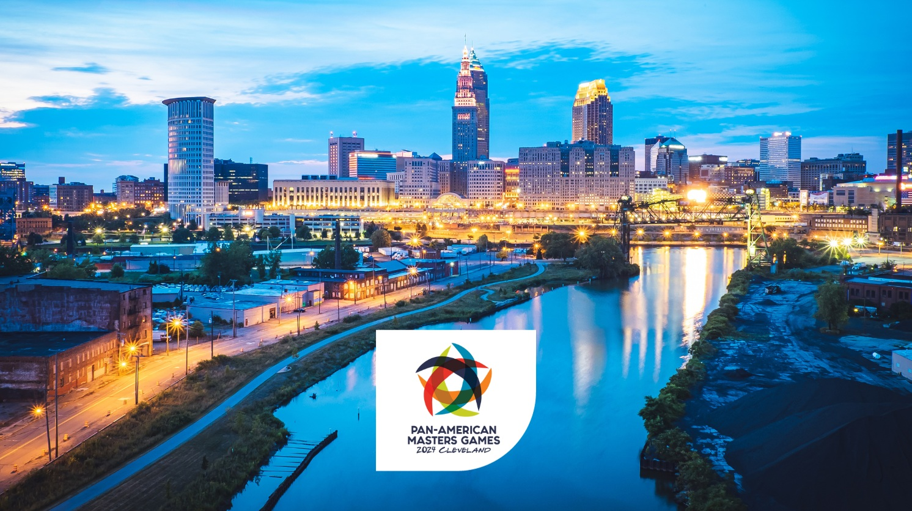

# Cleveland 2024

Scraped from [World Masters Sport — Next Masters Games](https://www.worldmasterssport.com/about-the-masters-games/next-masters-games/) on 2026-08-19 for IMGA athlete POC reference.

- **Event page:** https://www.worldmasterssport.com/about-the-masters-games/all-masters-games/pan-american-masters-games/cleveland-2024/
- **Map label:** 2024 Pan American Masters Games Cleveland

| Field | Value |
|---|---|
| Status | Previous |
| Event family | Pan American Masters Games |
| Country / location | USA |
| Dates | 12 – 21 Jul 2024 |
| Sports (count) | 24 |
| Venues | — |
| Participants | 3430 |
| Latitude | 41.4993 |
| Longitude | -81.6944 |
| Listing CTA | SEE MORE → https://www.worldmasterssport.com/about-the-masters-games/all-masters-games/pan-american-masters-games/cleveland-2024/ |

## Listing card

**Status banner:** Previous

**Listing copy:** Find out about Pan American Masters Games Cleveland 2024

**CTA:** SEE MORE — https://www.worldmasterssport.com/about-the-masters-games/all-masters-games/pan-american-masters-games/cleveland-2024/

## Event page details

**On-page title:** Cleveland 2024

**On-page subtitle:** Pan-American

**Theme / hero line:** Athletes Today, Competitors for Life

The Pan American Masters Games 2024 in Cleveland, USA, will be a dynamic celebration of athleticism, bringing together passionate athletes from across the Americas. With the theme “Athletes Today, Competitors for Life,” the event underscores the enduring drive and commitment of individuals who continue to compete, inspire, and thrive in sport throughout their lives..

## Sports programme

### Member sports

_Not listed on the source page._

### Other sports

_Not listed on the source page._

## Registration fees

_No fee table/screenshot published on the event page (or not applicable for a past event)._

## Athlete comments

**“Learning a new sport is exciting!”**

“There are people that say: why you keep doing that, why are you doing that at your age? Well, because we still can and it is never too late to start and learn new things. It’s exciting!”

**“I just want to see what I’m capable of!”**

“If you want to do something, you do it, go for it! You don’t have to be in this. I’m swimming against myself, I’m living against myself.”

**“We have so much fun and you share special moments together”**

“You’re always among friends, and you have a lot of fun, and you cry together, you laugh together, you’re disappointed together.. But most of the time you just have fun.”

## Source notes

- Images are local copies of public assets on worldmasterssport.com, stored for design/reference only.
- Copy is transcribed from the live site; typos on the source page are kept as-is.
