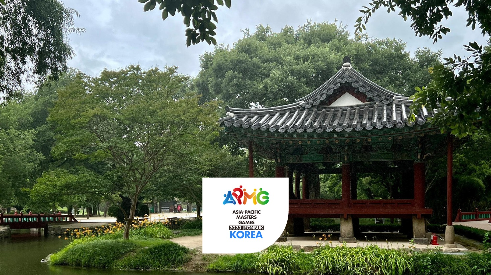

# Jeonbuk 2023

Scraped from [World Masters Sport — Next Masters Games](https://www.worldmasterssport.com/about-the-masters-games/next-masters-games/) on 2026-08-19 for IMGA athlete POC reference.

- **Event page:** https://www.worldmasterssport.com/about-the-masters-games/all-masters-games/asia-pacific-masters-games/jeonbuk-2023/
- **Map label:** 2023 Asia Pacific Masters Games Jeonbuk

| Field | Value |
|---|---|
| Status | Previous |
| Event family | Asia Pacific Masters Games |
| Country / location | South Korea |
| Dates | 12 – 20 May 2023 |
| Sports (count) | 29 |
| Venues | — |
| Participants | 7663 |
| Latitude | 35.7492 |
| Longitude | 127.1259 |
| Listing CTA | SEE MORE → https://www.worldmasterssport.com/about-the-masters-games/all-masters-games/asia-pacific-masters-games/jeonbuk-2023/ |

## Listing card

**Status banner:** Previous

**Listing copy:** Find out about Asia Pacific Masters Games Jeonbuk 2023

**CTA:** SEE MORE — https://www.worldmasterssport.com/about-the-masters-games/all-masters-games/asia-pacific-masters-games/jeonbuk-2023/

## Event page details

**On-page title:** Jeonbuk 2023

**On-page subtitle:** Asia Pacific

**Theme / hero line:** Play Sport, Play Life!

The Asia Pacific Masters Games 2023 in Jeonbuk, South Korea, brought together athletes from across the region for a vibrant celebration of sport, health, and community. With the theme “Play Sport, Play Life,” the event emphasized the importance of staying active and engaged, showcasing how sport enhances both physical well-being and the joy of life at any age.

## Sports programme

### Member sports

_Not listed on the source page._

### Other sports

_Not listed on the source page._

## Registration fees

_No fee table/screenshot published on the event page (or not applicable for a past event)._

## Athlete comments

**“You get motivated to start again!”**

“Seeing other people playing it’s kind of inspiring to think about taking other things up again.”

**“Sport is fitness, health and community!”**

Sport keeps us fit, it keeps people healthy and you can see from the smiles on the faces what it means to them to be still active and competing in events like this and meeting people throughout their whole lives.

**“I meet great people playing sport!”**

Sport’s everything, I need it for my wellbeing, it helps me push myself, it keeps me fit and you meet great people as well.

## Source notes

- Images are local copies of public assets on worldmasterssport.com, stored for design/reference only.
- Copy is transcribed from the live site; typos on the source page are kept as-is.
