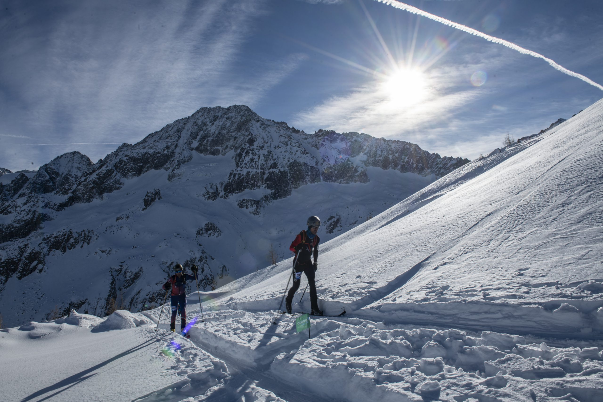

# Lombardia 2024

Scraped from [World Masters Sport — Next Masters Games](https://www.worldmasterssport.com/about-the-masters-games/next-masters-games/) on 2026-08-19 for IMGA athlete POC reference.

- **Event page:** https://www.worldmasterssport.com/about-the-masters-games/all-masters-games/winter-world-masters-games/lombardia-2024/
- **Map label:** 2024 Winter World Masters Games Lombardy

| Field | Value |
|---|---|
| Status | Previous |
| Event family | Winter World Masters Games |
| Country / location | Italy |
| Dates | 12 – 21 Jan 2024 |
| Sports (count) | 10 |
| Venues | — |
| Participants | 2165 |
| Latitude | 45.4791 |
| Longitude | 9.8452 |
| Listing CTA | SEE MORE → https://www.worldmasterssport.com/about-the-masters-games/all-masters-games/winter-world-masters-games/lombardia-2024/ |

## Listing card

**Status banner:** Previous

**Listing copy:** Find out about Winter World Masters Games Lombardia 2024

**CTA:** SEE MORE — https://www.worldmasterssport.com/about-the-masters-games/all-masters-games/winter-world-masters-games/lombardia-2024/

## Event page details

**On-page title:** Lombardia 2024

**On-page subtitle:** Winter World Masters

**Theme / hero line:** Enjoy your passion !

The Lombardia 2024 Winter World Masters Games invited athletes from around the globe to enjoy your passion amid the stunning Italian Alps. With thrilling competition and a vibrant festival atmosphere, the Games celebrated the joy of winter sport and the enduring spirit of the Masters community.

## Sports programme

### Member sports

_Not listed on the source page._

### Other sports

_Not listed on the source page._

## Registration fees

_No fee table/screenshot published on the event page (or not applicable for a past event)._

## Athlete comments

**“The community is amazing!”**

“All the years that we played, we met so many great people.”

**“So exciting to experience other countries and cultures”**

“I think the most part is the cultures of the countries you come to visit, and experiencing the people.”

**“Go and do it, choose to live!”**

“I want to choose to live my life, you only get one chance so why ywaste it, why waste your life thinking I wish I’d done something. Do it, get up, get out of your chair, Go and do it!”

## Source notes

- Images are local copies of public assets on worldmasterssport.com, stored for design/reference only.
- Copy is transcribed from the live site; typos on the source page are kept as-is.
