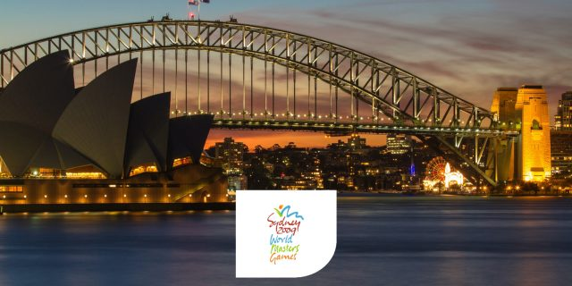
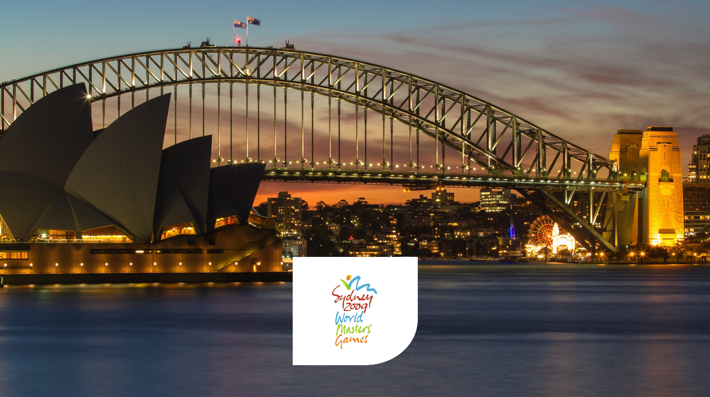

# Sydney 2009

Scraped from [World Masters Sport — Next Masters Games](https://www.worldmasterssport.com/about-the-masters-games/next-masters-games/) on 2026-08-19 for IMGA athlete POC reference.

- **Event page:** https://www.worldmasterssport.com/about-the-masters-games/all-masters-games/world-masters-games/sydney-2009/
- **Map label:** 2009 World Masters Games Sydney

| Field | Value |
|---|---|
| Status | Previous |
| Event family | World Masters Games |
| Country / location | Australia |
| Dates | 10 – 18 Oct 2009 |
| Sports (count) | 28 |
| Venues | — |
| Participants | 28676 |
| Latitude | -33.8727 |
| Longitude | 151.2057 |
| Listing CTA | SEE MORE → https://www.worldmasterssport.com/world-masters-games/sydney-2009/ |

## Listing card

**Status banner:** Previous

**Listing copy:** Find out about World Masters Games Sydney 2009

**CTA:** SEE MORE — https://www.worldmasterssport.com/world-masters-games/sydney-2009/

## Event page details

**On-page title:** Sydney 2009

**On-page subtitle:** World Masters

**Theme / hero line:** Fit, Fun and Forever Young

The Sydney 2009 World Masters Games embodied the spirit of being fit, fun, and forever young, as tens of thousands of athletes competed across the city’s iconic venues. With unforgettable moments of camaraderie and celebration, the Games left a vibrant legacy of health, joy, and lifelong passion for sport.

## Sports programme

### Member sports

_Not listed on the source page._

### Other sports

_Not listed on the source page._

## Registration fees

_No fee table/screenshot published on the event page (or not applicable for a past event)._

## Athlete comments

**“The support and the big crowd are incredible”**

The crowd is awesome. There were a lot of friends and family, it was a really nice atmosphere and I have noticed that across the board people are just so supportive.

**“Inspiration everywhere to just get up and do it!”**

“You watch the Olympics and people are in awe of performance. You watch an event like this, you know the 40, 50, 60 year old age group, hopefully it inspires people to get out of the arm chair and say: ‘Actually, I could do that!”

**“The community is amazing!”**

“All the years that we played, we met so many great people.”

## Source notes

- Images are local copies of public assets on worldmasterssport.com, stored for design/reference only.
- Copy is transcribed from the live site; typos on the source page are kept as-is.
