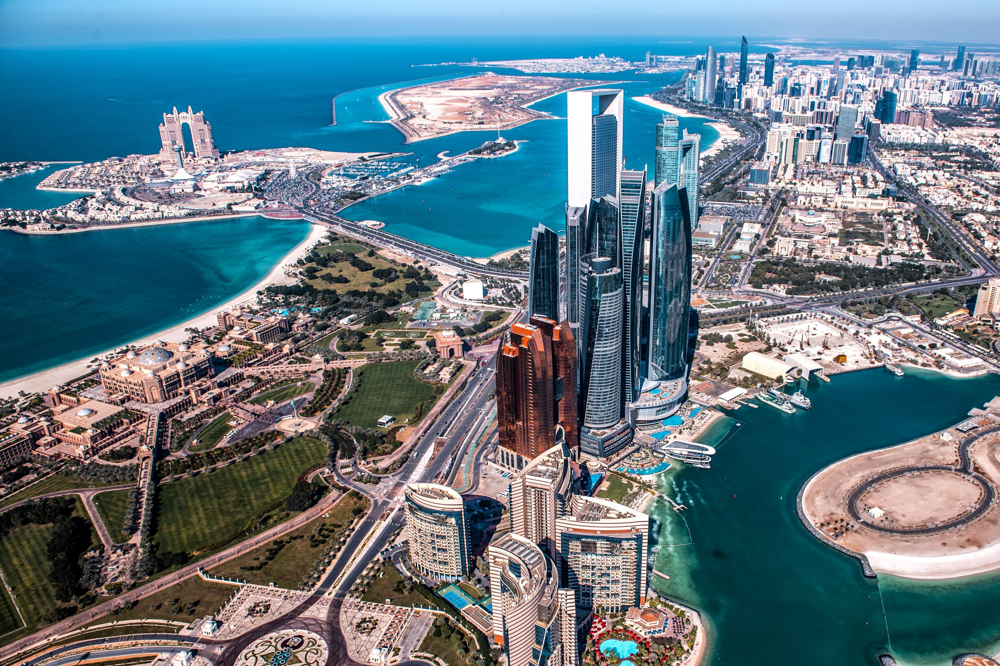

# Taipei 2025

Scraped from [World Masters Sport — Next Masters Games](https://www.worldmasterssport.com/about-the-masters-games/next-masters-games/) on 2026-08-19 for IMGA athlete POC reference.

- **Event page:** https://www.worldmasterssport.com/about-the-masters-games/all-masters-games/world-masters-games/taipei-2025/
- **Map label:** —

| Field | Value |
|---|---|
| Status | Previous |
| Event family | World Masters Games |
| Country / location | Taiwan |
| Dates | 17 – 30 May 2025 |
| Sports (count) | 35 |
| Venues | — |
| Participants | about 26,000 (WMS news coverage) |
| Latitude | — |
| Longitude | — |
| Listing CTA | SEE MORE → https://www.worldmasterssport.com/about-the-masters-games/all-masters-games/world-masters-games/taipei-2025/ |

## Listing card

**Status banner:** Previous

**Listing copy:** Find out about World Masters Games Taipei 2025

**CTA:** SEE MORE — https://www.worldmasterssport.com/about-the-masters-games/all-masters-games/world-masters-games/taipei-2025/

## Event page details

**On-page title:** Taipei 2025

**On-page subtitle:** World Masters Games (photo gallery page)

**Theme / hero line:** We inspired the world.

The strength, passion and joy of the masters athletes represented everything this global celebration stands for. Age is just a number, and we wanted the world to see it !

## Sports programme

### Member sports

_Not listed on the source page._

### Other sports

_Not listed on the source page._

## Registration fees

_No fee table/screenshot published on the event page (or not applicable for a past event)._

## Athlete comments

_None captured._

## Extra details from World Masters Sport pages

The Taipei 2025 event page is mostly a photo/video gallery. These extra facts appear on other official WMS pages:

- **Dates:** 17 – 30 May 2025 in Taipei and New Taipei City
- **Sports:** 35
- **Participants:** about 26,000
- Registration explainer: https://www.worldmasterssport.com/want-to-take-part-in-the-world-masters-games-taipei-2025-find-your-sport/
- News archive: https://www.worldmasterssport.com/category/imga-news/

## Source notes

- Images are local copies of public assets on worldmasterssport.com, stored for design/reference only.
- Copy is transcribed from the live site; typos on the source page are kept as-is.
