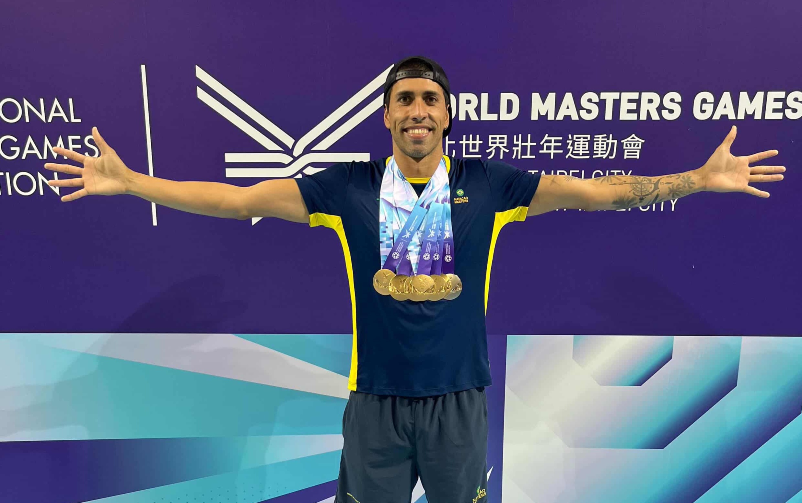

# Tampere 2023

Scraped from [World Masters Sport — Next Masters Games](https://www.worldmasterssport.com/about-the-masters-games/next-masters-games/) on 2026-08-19 for IMGA athlete POC reference.

- **Event page:** https://www.worldmasterssport.com/about-the-masters-games/all-masters-games/european-masters-games/tampere-2023
- **Map label:** 2023 European Masters Games Tampere

| Field | Value |
|---|---|
| Status | Previous |
| Event family | European Masters Games |
| Country / location | Finland |
| Dates | 26 – 09 Jul 2023 |
| Sports (count) | 29 |
| Venues | — |
| Participants | 3203 |
| Latitude | 61.4971 |
| Longitude | 23.7526 |
| Listing CTA | SEE MORE → https://www.worldmasterssport.com/about-the-masters-games/all-masters-games/european-masters-games/tampere-2023 |

## Listing card

**Status banner:** Previous

**Listing copy:** Find out about European Masters Games Tampere 2023

**CTA:** SEE MORE — https://www.worldmasterssport.com/about-the-masters-games/all-masters-games/european-masters-games/tampere-2023

## Event page details

**On-page title:** Tampere 2023

**On-page subtitle:** European

**Theme / hero line:** Sport For Life, Life Without Limits

The European Masters Games 2023 in Tampere, Finland, was a vibrant celebration of active living, uniting athletes from across Europe in a spirited display of competition and camaraderie. Embracing the theme “Sport for Life, Life Without Limits,” the event showcased the power of sport to inspire, connect, and promote lifelong wellness.

## Sports programme

### Member sports

_Not listed on the source page._

### Other sports

_Not listed on the source page._

## Registration fees

_No fee table/screenshot published on the event page (or not applicable for a past event)._

## Athlete comments

**“So exciting to experience other countries and cultures”**

“I think the most part is the cultures of the countries you come to visit, and experiencing the people.”

**“We love to see all the other sports as well!”**

“We try and attend different sports depending on what’s going on and depending on what we are doing in terms of sightseeing.”

**“Seeing the older athletes, I’m like, that’s what I want to do!”**

“The inspiration watching those in their 70s/80s, still out there running, I’m like, that’s what I want to do. There’s just no giving up.”

## Source notes

- Images are local copies of public assets on worldmasterssport.com, stored for design/reference only.
- Copy is transcribed from the live site; typos on the source page are kept as-is.
