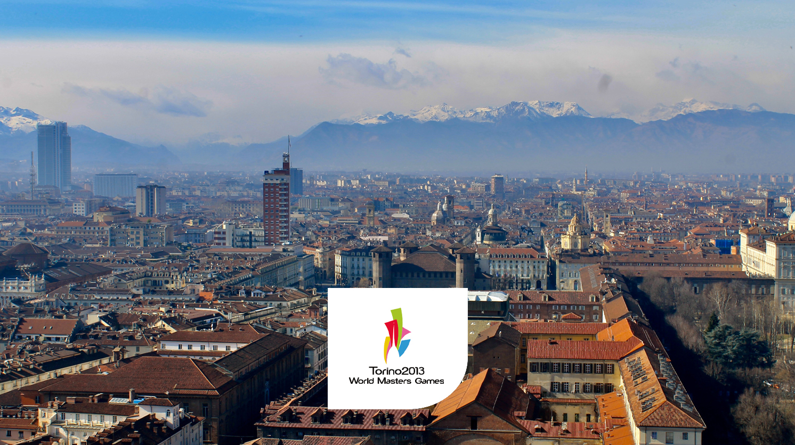

# Torino 2013

Scraped from [World Masters Sport — Next Masters Games](https://www.worldmasterssport.com/about-the-masters-games/next-masters-games/) on 2026-08-19 for IMGA athlete POC reference.

- **Event page:** https://www.worldmasterssport.com/about-the-masters-games/all-masters-games/world-masters-games/torino-2013/
- **Map label:** 2013 World Masters Games Torino

| Field | Value |
|---|---|
| Status | Previous |
| Event family | World Masters Games |
| Country / location | Italy |
| Dates | 02 – 11 Aug 2013 |
| Sports (count) | 26 |
| Venues | — |
| Participants | 19325 |
| Latitude | 45.0703 |
| Longitude | 7.6869 |
| Listing CTA | SEE MORE → https://www.worldmasterssport.com/world-masters-games/torino-2013/ |

## Listing card

**Status banner:** Previous

**Listing copy:** Find out about World Masters Games Torino 2013

**CTA:** SEE MORE — https://www.worldmasterssport.com/world-masters-games/torino-2013/

## Event page details

**On-page title:** Torino 2013

**On-page subtitle:** World Masters

**Theme / hero line:** Everlasting Passion

The Torino 2013 World Masters Games ignited the city with everlasting passion, uniting athletes of all ages in a timeless celebration of sport and friendship. Set against Turin’s rich history and vibrant culture, the Games left a legacy of inspiration that continues to shine.

## Sports programme

### Member sports

_Not listed on the source page._

### Other sports

_Not listed on the source page._

## Registration fees

_No fee table/screenshot published on the event page (or not applicable for a past event)._

## Athlete comments

**“Life is all about learning and trying new things!”**

“There’s never a moment to stop to learn. I still learn fron myself. It’s never too late to start to do something.”

**“Go and do it, choose to live!”**

“I want to choose to live my life, you only get one chance so why ywaste it, why waste your life thinking I wish I’d done something. Do it, get up, get out of your chair, Go and do it!”

**“See what your body can do and enjoy it!”**

“If you make the age and your body is willing, you can compete.”

## Source notes

- Images are local copies of public assets on worldmasterssport.com, stored for design/reference only.
- Copy is transcribed from the live site; typos on the source page are kept as-is.
