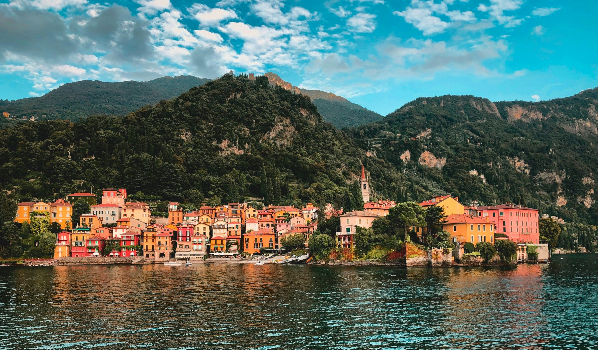

# OMG Como Lake 2027

Scraped from [World Masters Sport — Next Masters Games](https://www.worldmasterssport.com/about-the-masters-games/next-masters-games/) on 2026-08-19 for IMGA athlete POC reference.

- **Event page:** https://www.worldmasterssport.com/about-the-masters-games/next-masters-games/como-lake-2027/
- **Map label:** 2027 Open Masters Games Como Lake

| Field | Value |
|---|---|
| Status | Opening Fall 2026 |
| Event family | Open Masters Games |
| Country / location | Italy |
| Dates | 17 – 26 Sept 2027 |
| Sports (count) | 25 |
| Venues | TBD |
| Participants | — |
| Latitude | 45.8081 |
| Longitude | 9.0852 |
| Listing CTA | More info → https://www.worldmasterssport.com/about-the-masters-games/next-masters-games/como-lake-2027/ |

## Listing card

**Status banner:** Opening Fall 2026

**Listing copy:** We’re delighted to announce that the 2027 Open Masters Games will take place in Como Lake in Italy from 17 – 26 September 2027.

**CTA:** More info — https://www.worldmasterssport.com/about-the-masters-games/next-masters-games/como-lake-2027/

## Event page details

**On-page title:** Como Lake 2027

**On-page subtitle:** Open Masters Games

**Theme / hero line:** Discover the beauty of the Como region with the ultimate mix of sporting and leisure experiences
Wander the streets of Italy, enjoy the rich culture of food and wine together with playing sports with like-minded sports lovers from all over the world. Mark your calendar and start planning your trip !

## Sports programme

### Member sports

- Archery
- Athletics
- Badminton
- Beach Volley
- Basketball
- Canoe Kayak
- Cycling
- Floorball
- Football
- Golf
- Rowing
- Shooting
- Taekwondo
- Triathlon
- Volleyball
- Tennis

### Other sports

- Climbing
- Fencing
- Handball
- Judo
- Karate
- Padel
- Rugby
- Swimming
- Sky Running

## Registration fees

_No fee table/screenshot published on the event page (or not applicable for a past event)._

## Athlete comments

**“Learning a new sport is exciting!”**

“There are people that say: why you keep doing that, why are you doing that at your age? Well, because we still can and it is never too late to start and learn new things. It’s exciting!”

**“Life is all about learning and trying new things!”**

“There’s never a moment to stop to learn. I still learn fron myself. It’s never too late to start to do something.”

**“I compete to be healthy, inspired by the older athletes”**

“The first year I competed in the Swiss Masters Athletics, the guys that were 60 – 65 – 70 years old, they were my inspiration. I switched my mind to say: I still compete but I want to be healthy the rest of my life. They are the models.”

## Source notes

- Images are local copies of public assets on worldmasterssport.com, stored for design/reference only.
- Copy is transcribed from the live site; typos on the source page are kept as-is.
