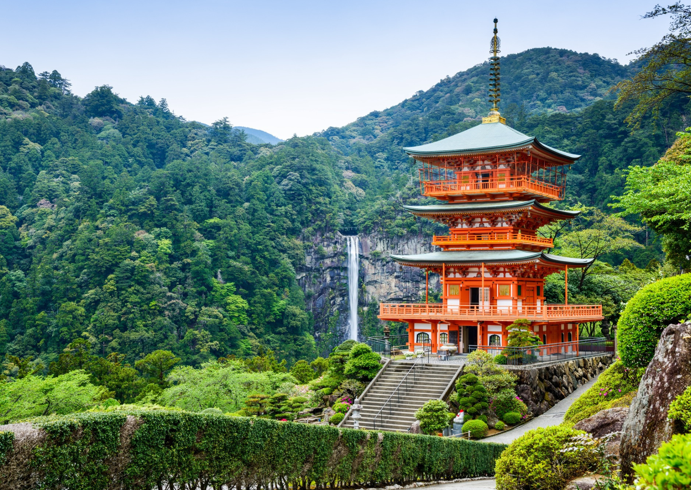
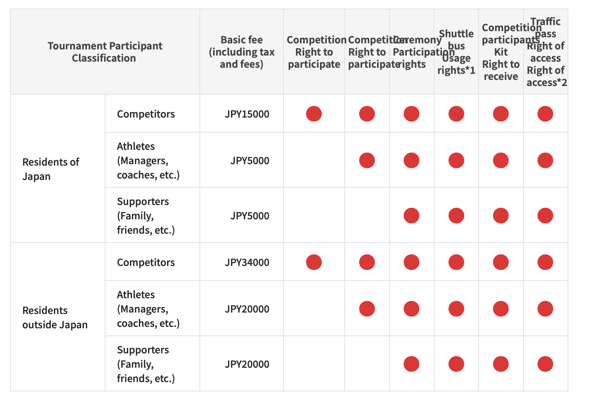

# WMG Kansai 2027

Scraped from [World Masters Sport — Next Masters Games](https://www.worldmasterssport.com/about-the-masters-games/next-masters-games/) on 2026-08-19 for IMGA athlete POC reference.

- **Event page:** https://www.worldmasterssport.com/about-the-masters-games/next-masters-games/kansai-2027/
- **Map label:** 2027 World Masters Games Kansai

| Field | Value |
|---|---|
| Status | Open Now ! |
| Event family | World Masters Games |
| Country / location | Japan (Kansai) |
| Dates | 14 – 30 May 2027 |
| Sports (count) | 35 |
| Venues | 61 |
| Participants | — |
| Latitude | 34.6937 |
| Longitude | 135.5023 |
| Listing CTA | Register → https://www.worldmasterssport.com/about-the-masters-games/next-masters-games/kansai-2027/ |

## Listing card

**Status banner:** Open Now !

**Listing copy:** We’re delighted to announce that the 2027 World Masters Games will take place in Kansai in Japan from 14 – 30 May 2027.

**CTA:** Register — https://www.worldmasterssport.com/about-the-masters-games/next-masters-games/kansai-2027/

## Event page details

**On-page title:** Kansai 2027

**On-page subtitle:** World Masters Games

**Theme / hero line:** Get ready for the ultimate sport experience while discovering Japan’s stunning culture and scenery
Be part of the vibrant Masters community in Japan while challenging yourself internationally against other athletes from all around the world. Don’t miss the this spectacular and fun event !

## Sports programme

### Member sports

- Archery
- Athletics
- Badminton
- Baseball
- Basketball
- Canoe Kayak
- Cycling
- Dance Sport
- Football
- Flying Disc
- Golf
- Field Hockey
- Life Saving
- Orienteering
- Rowing
- Shooting
- Softball
- Squash
- Table Tennis
- Taekwondo
- Tennis
- Triathlon
- Volleyball
- Weightlifting

### Other sports

- Gateball
- Ground Golf
- Handball
- Judo
- Karate
- Swimming
- Rugby
- Sailing
- Soft Tennis
- Diving
- Waterpolo
- Artistic Swimming
- Bowling
- Tug of War

## Registration fees

## Athlete comments

**“You get motivated to start again!”**

“Seeing other people playing it’s kind of inspiring to think about taking other things up again.”

**“The vibe and atmosphere is just amazing”**

“I’m being really impressed by our results, everyone has tried their hardest. We’ve got the medals. You feel good. It’s just a lovely vibe, it’s been a very friendly atmosphere, everyone has been very welcoming, it’s been very well organised and we’re very grateful for that.”

## Source notes

- Images are local copies of public assets on worldmasterssport.com, stored for design/reference only.
- Copy is transcribed from the live site; typos on the source page are kept as-is.
