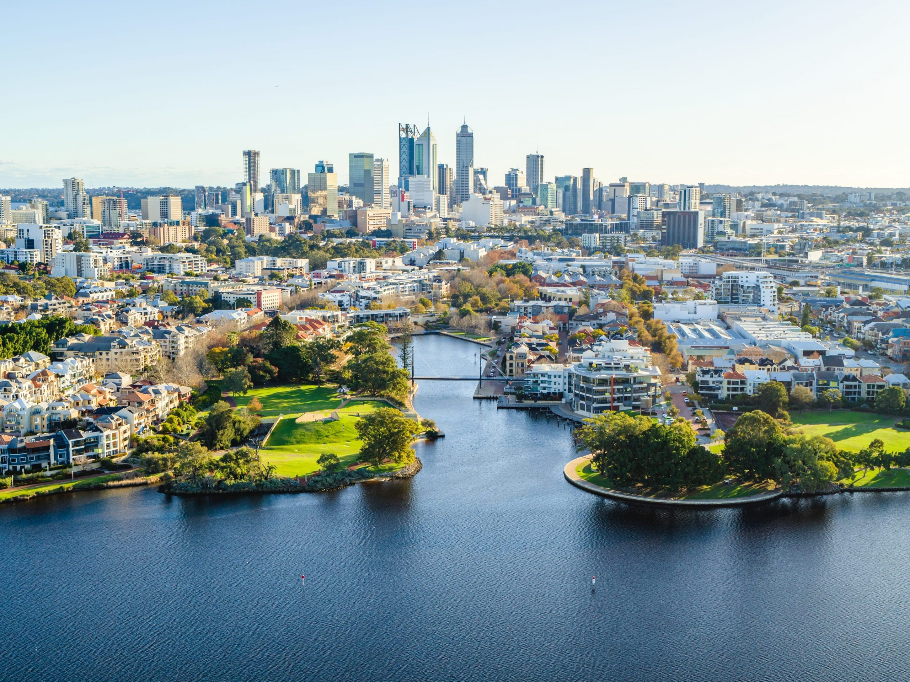
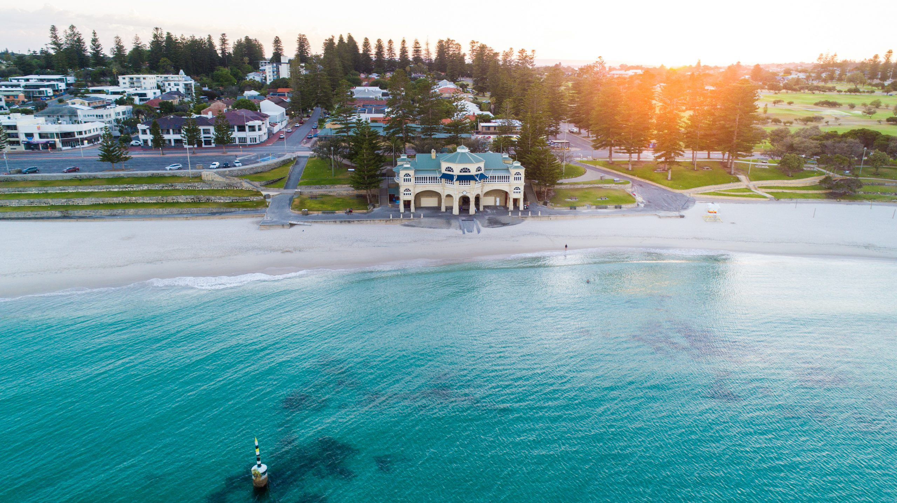

# WMG Perth 2029

Scraped from [World Masters Sport — Next Masters Games](https://www.worldmasterssport.com/about-the-masters-games/next-masters-games/) on 2026-08-19 for IMGA athlete POC reference.

- **Event page:** https://www.worldmasterssport.com/about-the-masters-games/next-masters-games/perth-2029
- **Map label:** 2029 World Masters Games Perth

| Field | Value |
|---|---|
| Status | Opening 2028 |
| Event family | World Masters Games |
| Country / location | Australia |
| Dates | 12 – 23 Oct 2029 |
| Sports (count) | TBD |
| Venues | TBD |
| Participants | — |
| Latitude | -31.9505 |
| Longitude | 115.8605 |
| Listing CTA | More info → https://www.worldmasterssport.com/about-the-masters-games/next-masters-games/perth-2029 |

## Listing card

**Status banner:** Opening 2028

**Listing copy:** We’re delighted to announce that the 2029 World Masters Games will take place in Perth Australia in 2029

**CTA:** More info — https://www.worldmasterssport.com/about-the-masters-games/next-masters-games/perth-2029

## Event page details

**On-page title:** Perth 2029

**On-page subtitle:** World Masters Games

**Theme / hero line:** From the coast to the world stage Perth will show unity, passion and a sporting spirit
The world will come together in Perth to celebrate the joined passion for sports. Against the backdrop of Australia’s vibrant west coast, tradition and inspiration meet in a festival of sport, culture and global connections.

## Sports programme

### Member sports

_Not listed on the source page._

### Other sports

_Not listed on the source page._

## Registration fees

_No fee table/screenshot published on the event page (or not applicable for a past event)._

## Athlete comments

**“We love to move and stay active as a family”**

“We’re always busy doing something, and if it’s physical, the better.”

**“We love to visit new places!”**

“Our players love playing basketball, but they also love travel so this is an opportunity to marry those things together.”

**“Incredible to see so many different athletes and sports”**

“Just seeing everybody from all over the world in different sports. It’s just incredible to talk to so many different athletes and hear their stories.”

## Source notes

- Images are local copies of public assets on worldmasterssport.com, stored for design/reference only.
- Copy is transcribed from the live site; typos on the source page are kept as-is.
