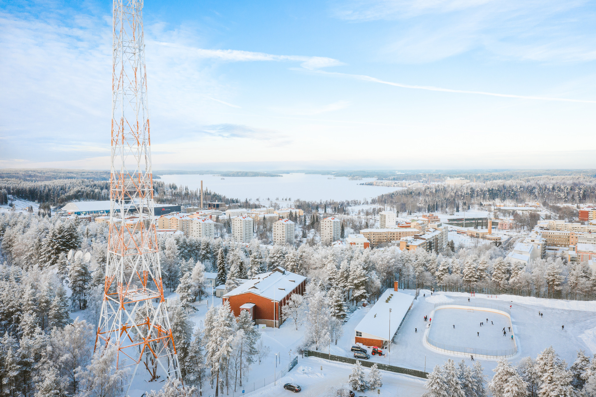
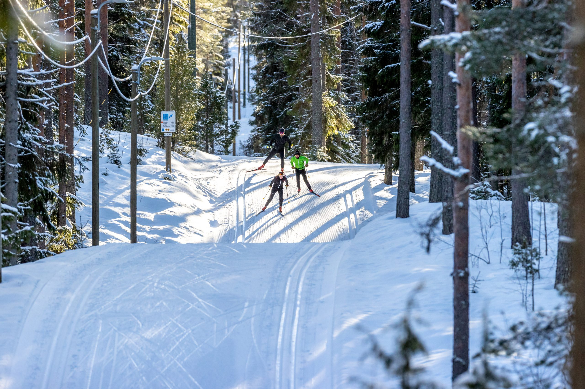

# WWMG Lahti 2028

Scraped from [World Masters Sport — Next Masters Games](https://www.worldmasterssport.com/about-the-masters-games/next-masters-games/) on 2026-08-19 for IMGA athlete POC reference.

- **Event page:** https://www.worldmasterssport.com/about-the-masters-games/next-masters-games/lahti-2028
- **Map label:** 2028 Winter World Masters Games Lahti

| Field | Value |
|---|---|
| Status | Pre-Register Now |
| Event family | Winter World Masters Games |
| Country / location | Finland |
| Dates | 14 – 23 Jan 2028 |
| Sports (count) | 12 |
| Venues | TBD |
| Participants | — |
| Latitude | 60.9827 |
| Longitude | 25.6615 |
| Listing CTA | More info → https://www.worldmasterssport.com/about-the-masters-games/next-masters-games/lahti-2028 |

## Listing card

**Status banner:** Pre-Register Now

**Listing copy:** We’re delighted to announce that the 2028 Winter World Masters Games will take place in Lahti, Finland between January and March 2028.

**CTA:** More info — https://www.worldmasterssport.com/about-the-masters-games/next-masters-games/lahti-2028

## Event page details

**On-page title:** Lahti 2028

**On-page subtitle:** Winter World Masters Games

**Theme / hero line:** Magical winter setting awaits for the 5th edition of the Winter World Masters Games
In 2028 Lahti will welcome everyone to share in the joy of Winter. Beyond the competitions, it will be a celebration of togetherness, adventures and unforgettable memories between winter athletes from around the globe.

## Sports programme

### Member sports

- Alpine Ski
- Biathlon
- Cross Country
- Curling
- Figure Skating
- Ice Hockey
- Nordic Combi
- Short Track
- Ski Jumping
- Snow Run
- Speed Skating
- Disc Golf

### Other sports

_Not listed on the source page._

## Registration fees

_No fee table/screenshot published on the event page (or not applicable for a past event)._

## Athlete comments

**“Learning a new sport is exciting!”**

“There are people that say: why you keep doing that, why are you doing that at your age? Well, because we still can and it is never too late to start and learn new things. It’s exciting!”

**“We love to move and stay active as a family”**

“We’re always busy doing something, and if it’s physical, the better.”

## Source notes

- Images are local copies of public assets on worldmasterssport.com, stored for design/reference only.
- Copy is transcribed from the live site; typos on the source page are kept as-is.
